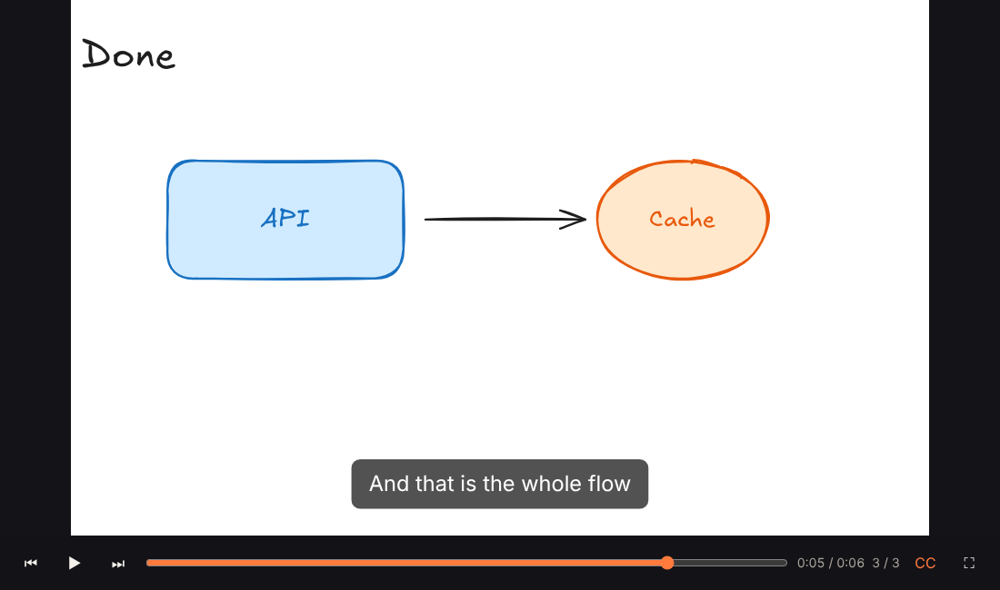
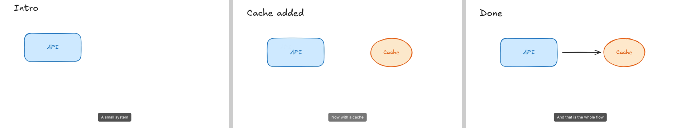
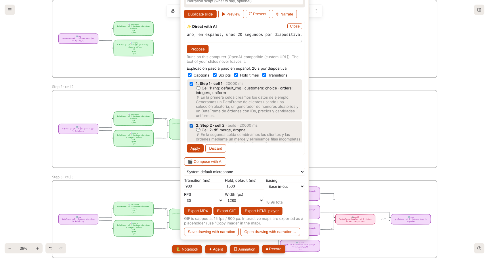
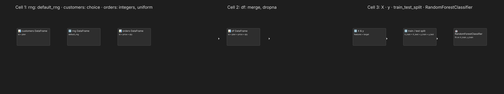
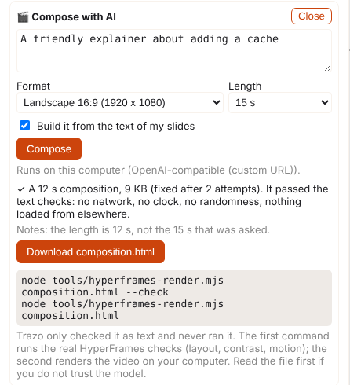

# HTML player and HyperFrames video

**Animation → Export HTML player** saves your slides as **one `.html` file** that is two things at once:

1. a **player** that works offline in any browser (a phone included): play, pause, scrub, previous / next slide, captions, narration, full screen, with the same transitions as the editor (Smart, Fade, Cut, Build, Pan);
2. a **[HyperFrames](https://github.com/heygen-com/hyperframes) composition**: HyperFrames is an open source (Apache 2.0) framework that renders HTML to video by asking a headless Chrome for each frame, one by one. Because the file is a composition, you can turn it into a **4K, 60 fps or transparent video, frame accurate and reproducible**, from your own machine.



## Why this is different from Export MP4

|  | Export MP4 / GIF (in the browser) | HTML player | HyperFrames render of that file |
| --- | --- | --- | --- |
| Result | a video | a vector page you can open, share and embed | a video |
| Quality | what the browser's encoder gives at the width you chose | sharp at any size, selectable at any zoom | CRF 16 by default, up to 4K and 240 fps, ProRes with alpha, WebM, GIF, HLS, PNG sequence |
| Same picture every time | depends on the browser | yes | yes: each frame is requested by its time, never "played" |
| Narration | mixed into the MP4 | inside the file, in sync | mixed into the video with AAC |
| Needs | Chrome or Edge (WebCodecs) | any browser | Node 22, FFmpeg, Chrome (it runs on your machine) |

The picture is drawn by **Excalidraw's own SVG renderer** and Trazo's own timeline, bundled into the file, so a slide looks exactly like it does in the editor, hand-drawn strokes included. Nothing is fetched: slides, images, the fonts the slides use and the narration are all inside the file (about 350 KB plus your images and audio; the narration is 16 bit mono at 24 kHz, about 2.9 MB per minute).

Frames of the video that HyperFrames rendered from that file (1920 x 1080, with the narration track):



## Use it

1. **Animation → Export HTML player.** It saves `animation.html` (the narration is included when you have recorded it and "Use my narration" is ticked). The size of the composition is the **Width** setting, with the aspect ratio of your first slide.
2. Open it in a browser. Click or `Space` plays and pauses, `←` `→` change slide, `C` toggles captions, `F` is full screen, `Home` goes back to the start. The controls fade out while it plays.
3. For a video, with Node.js 22+, FFmpeg and Chrome or Chromium installed:

```
node tools/hyperframes-render.mjs animation.html
node tools/hyperframes-render.mjs animation.html --size 1920x1080 --resolution 4k --fps 60 --quality delivery -o talk-4k.mp4
node tools/hyperframes-render.mjs animation.html --format webm
```

Options: `-o/--output`, `-f/--fps`, `-q/--quality draft|standard|looks|delivery`, `--format mp4|webm|mov|gif|png-sequence|hls`, `--size WxH` (the animation is drawn at this size, the slide centered in it), `--resolution 1080p|4k|…` (more pixels at the same layout; the aspect ratio must match, so use `--size 1920x1080 --resolution 4k` for 4K), `-w/--workers`, `--docker` (Chromium, fonts and FFmpeg pinned, identical on every machine). Set `PUPPETEER_EXECUTABLE_PATH` to use your own Chrome.

The script writes the narration out as a real file (HyperFrames mixes audio from files, not from `data:` URIs), renders in a temporary folder and removes it. It uses `hyperframes@0.8.162`, the version this was tested with.

## What was verified

Run against `hyperframes` 0.8.162 on Linux (Node 22, FFmpeg, headless Chrome 152):

- A composition with **no animation library at all** renders: Trazo registers its own seekable timeline in `window.__timelines["trazo"]` (`duration`, `seek`, `time`, `totalTime`, `progress`, `pause`, `paused`). HyperFrames' starter project loads GSAP from a CDN, which fails offline; this file has no external dependency.
- The frames are drawn **asynchronously** (the SVG renderer is async) and still come out right: a test with a timeline that only moves its element after a microtask and a timer produced the correct frame at 0.5 s, 1.0 s and 1.9 s.
- A real export from the app (three slides, Smart and Build transitions, captions, the Excalifont hand-drawn font inlined) renders to a 1280 x 800, 30 fps, 6.4 s H.264 video in 13 s, with the controls hidden and the captions in place; `--size 1920x1080` gives 1920 x 1080.
- **Narration** is mixed into an AAC track when it is a file. A `data:` URI is refused by HyperFrames ("Source not found for audio element"), which is why the render script extracts it.
- The page tells it is being rendered (`window.__hf` exists and `navigator.webdriver` is true) and hides the controls; add `?render` to the address to see the same view in a normal browser.

Not verified: GPU encoding, `--hdr`, `--docker`, Windows and macOS, very long animations, animations with many large images.

## Local-first notes

- The app itself never talks to HyperFrames; the render is a separate command you run.
- `npx` downloads the `hyperframes` package the first time (from the npm registry). That is the only network use, and it is in this optional tool.
- HyperFrames sends anonymous usage data and checks npm for updates unless told not to; the script sets `HYPERFRAMES_NO_TELEMETRY=1`, `DO_NOT_TRACK=1` and `HYPERFRAMES_NO_UPDATE_CHECK=1`.
- Your animation is never uploaded: rendering is local (the `cloud` and `lambda` commands of HyperFrames are not used).

## How it is built

`excalidraw-app/animation/htmlPlayer.ts` builds the file (pure, tested): the HyperFrames attributes (`data-composition-id`, `data-width`, `data-height`, `data-fps`, `data-duration`, a timed `class="clip"` stage), the payload (the slides as Excalidraw elements, the image files they use, the settings), the inlined fonts, the narration as an `<audio>` with `data-start` / `data-duration`, and the player script. The script is `excalidraw-app/animation/player/runtime.ts`: the real `timeline.ts` plus `exportToSvg`, bundled with esbuild by a small Vite plugin (`player/vitePlugin.ts`, `import … from "./runtime.ts?bundle"`) so it works the same in `yarn start` and in the production build. The font subsetting WebAssembly and the CJK font files are left out of that bundle (the app inlines the fonts, and the player draws with them as they are); it comes to about 310 KB.

## Your own AI as director and as author

HyperFrames was made to be driven by AI agents, and Trazo already connects to **your own** model (Ollama, LM Studio, an OpenAI-compatible server, Anthropic, or the CLI bridge: see [AI.md](AI.md)). Three things use it, in order of how much freedom the model gets. The first two never let it write code.

### 1. ✨ Direct with AI: captions, scripts, timing, transitions

In the Animation panel, **✨ Direct with AI**. The model reads what is on each slide (the texts, the kinds of shapes, and what is **new** compared with the previous slide) and proposes, for each slide:

- a **caption**,
- a **narration script** (1 to 3 spoken sentences about what the slide adds),
- how long it should **stay** on screen,
- the **transition** into it (Smart, Build, Fade, Cut, Pan), with the reason spelled out in the prompt: Build when a slide adds things to explain a flow, Fade for a change of topic, Cut for title cards, Pan to zoom into a detail.

You can write a note first ("for the sales team, friendly, in Spanish, short"). The answer is a small JSON that Trazo **validates field by field** (unknown slides, out-of-range times, unknown transitions and over-long texts are dropped and listed, never "fixed"), then shows slide by slide with checkboxes. **Apply** changes only what you ticked, as one undoable step (Ctrl+Z). The model never edits the canvas and never writes code, so a bad answer cannot break anything, and a small local model is enough.



The script is stored on the slide (`customData.script`, in the slide list under the caption) and is used three ways:

1. **Teleprompter**: while you record your voice (🎙 Narrate) the script of the current slide is shown under the status line.
2. **Hold time**: a script raises the hold of its slide so the slide stays as long as it takes to say (about 2.5 words per second).
3. **A voice, without a microphone**: `tools/hyperframes-render.mjs animation.html --tts` makes a voice clip for each script **on your computer** and puts it in the video.

### 2. A voice from the scripts, offline

```
pip install kokoro-onnx soundfile          # once: HyperFrames' local text to speech (Kokoro-82M)
node tools/hyperframes-render.mjs animation.html --tts --lang es --size 1920x1080 --save-player talk.html
```

`--lang` picks a voice (English, British English, Spanish, French, Italian, Portuguese, Hindi, Japanese, Chinese); `--voice` chooses one by id (`ef_dora`, `af_heart`, …) and `--speed` changes the pace. Each clip is placed on the timeline **where its slide begins**, and a slide that is shorter than its clip is **lengthened** to fit (plus the usual 0.4 s tail), using the app's own timeline code, so the picture follows the voice. `--save-player` also saves the animation with that narration inside it, as an offline player that speaks. The first run downloads the voice model (about 27 MB per voice plus the model); after that it works offline. Nothing is uploaded.

Verified: three scripted slides became a 14.1 s, 1920 x 1080 H.264 video with an AAC track whose speech starts where each slide starts.

### 3. 🎬 Compose with AI: a motion graphic written by the model

For things the slides cannot express (kinetic titles, an explainer that grows scene by scene), **🎬 Compose with AI** asks your model for a whole **HyperFrames composition**: you give a brief, a format (16:9, 9:16 or 1:1), a length, and optionally your slides to build from: the **caption and narration script** of each slide when it has one (for example the captions of _Slides from notebook_ or what _Direct with AI_ wrote), plus the labels drawn on it. What comes back is **never run inside Trazo**. It is checked as text, and refused if it could:

- reach the network (`fetch`, `XMLHttpRequest`, `WebSocket`, any `http(s)` address, `<link>`, `<script src>`, `@import`, `<iframe>`…);
- use the clock or randomness (`Date`, `performance.now`, `Math.random`, `requestAnimationFrame`, `setTimeout`…), which would also make frames differ between runs;
- run dynamic code (`eval`, `new Function`, `import()`), use storage or cookies, touch `window.open` / `navigator` / `parent`, or carry inline event handlers.

When a file is refused, the **reasons are sent back to the model** and it tries again (up to three attempts). A file that passes is saved as `composition.html`. The model builds on a tiny helper that Trazo inserts into the file, `trazoTimeline(id, seconds).add(target, keyframes, {start, duration, easing, stagger})`: every animation is a paused Web Animation that is moved to the asked time, so any frame can be requested in any order and looks the same. It needs no GSAP and no network, which makes it small enough for a modest model to use correctly. A model writing the example below was told only the rules in `AUTHOR_SYSTEM`.



Then, on your computer:

```
node tools/hyperframes-render.mjs composition.html --check      # HyperFrames' own checks
node tools/hyperframes-render.mjs composition.html              # the video
```

`--check` runs HyperFrames' `check`: lint, runtime, **layout** (text outside the frame, text hidden under another element, overlaps), **motion** and **contrast** (WCAG AA). It earns its place: while building this, it found real mistakes in the first example, a panel that overflowed the frame and scenes that overlapped because two animations of the same element clashed (the helper now handles that: only the earliest animation of a property applies before its start). Add `--json` for the report an agent can read, which is what a repair loop would use. `docs/examples/cache-explainer.html` is a finished composition (12 s, 1920 x 1080) that passes all the checks: `node tools/hyperframes-render.mjs docs/examples/cache-explainer.html`.

What this does **not** do: the text checks are a fence, not a proof. A determined model could write something unpleasant that the patterns do not catch, which is why the file is rendered by HyperFrames in a headless browser on your machine and not in Trazo, and why you can read it first (it is plain HTML). Compositions with a lot of generated detail are better suited to a capable model; a small one may need several attempts or a simpler brief.

### What your model sees

- **Direct with AI** sends the text of your slides, their shapes (counts only) and your note. **Compose with AI** sends your brief and, if you leave the box ticked, the text, caption and script of your slides. No image, no file, nothing else. With a local connection (Ollama, LM Studio) it stays on your computer; with a cloud connection the panel says it goes to that provider.
- The text to speech is local; the render is local.


