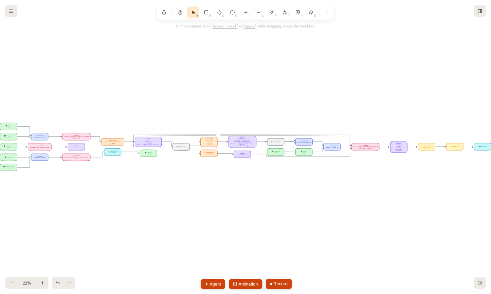
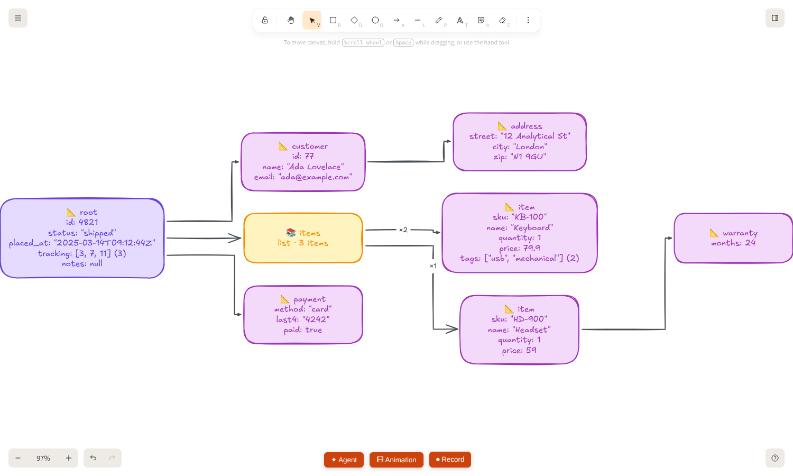

# Import to diagram

**Menu → Import to diagram…** (or the command palette: "Import to diagram") turns what you already have into a diagram on the canvas:

- a **`docker-compose.yml`**,
- **Kubernetes manifests** (YAML or JSON, one or many documents),
- **Terraform** files (`.tf`) or **Terraform JSON** (`terraform show -json`, a plan or a state),
- an **OpenAPI / Swagger** file (YAML or JSON),
- **SQL** `CREATE TABLE` statements, as an entity relationship diagram,
- **SQL queries** (`SELECT`, `WITH`, `INSERT`, `UPDATE`, `DELETE`, `MERGE`, `CREATE VIEW … AS`), as a diagram of how the query runs,
- a **dbt `manifest.json`**, as a lineage graph,
- an **n8n workflow** (the JSON you export from n8n),
- a **Jupyter notebook** (`.ipynb`),
- **any other JSON** (an API response, a config, an export, GeoJSON…), as a diagram of its shape.

It is **deterministic and offline**: the text is parsed in your browser and laid out by plain code. No AI is involved, nothing is sent anywhere, and the same input always gives the same diagram.

## How to use it

1. Open the dialog and paste the text, or press **Choose files…** (you can pick several at once). **Load an example…** fills the box with a sample of any format.
2. Trazo works out which format it is and says so under the box ("Detected Kubernetes: 14 boxes"), including what it left out.
3. Press **Generate diagram**. The diagram is added **below** whatever is already on the canvas and the view fits to it.
4. Everything is normal, editable Excalidraw shapes: move, recolor, animate it with slides. Arrows stay bound to their shapes, so dragging a box drags its arrows.

Layout is left to right. For infrastructure: the Internet first, then whatever nobody depends on (proxies, ingresses, apps), and on the right what they depend on (databases, caches, queues). For data flows (dbt, n8n): upstream on the left, downstream on the right, with each column ordered to keep arrows from crossing. Dashed boxes (volumes, config, claims) hang under the first thing that uses them. Boxes grow with their text.

Arrows are **elbow arrows** (only horizontal and vertical segments). Each one leaves the side of its box that faces the target and goes around every other box instead of through it; arrows that share a side of a box are spread along it, and when several could use the same lane they avoid each other where there is room. The routing is plain code (`excalidraw-app/infra/route.ts`, an A\* search over the lines just outside the boxes), still offline and deterministic. Arrows stay bound to their boxes.

## Docker Compose

| Compose | Diagram |
| --- | --- |
| each service | a rounded box with an emoji for its role, the name, the image and the published ports |
| `ports: ["8080:80"]` | an arrow from an **Internet** node to the service, labelled `8080→80` (only published ports; `"80"` alone is internal and is skipped) |
| `depends_on` (list or map) and legacy `links` | an arrow from the service to what it depends on |
| named `volumes` | a dashed box under the first service that mounts it, with a dashed line to every service that does (bind mounts and anonymous volumes are skipped) |

`extends`, `include` and `.env` substitution are not resolved; YAML anchors and merge keys (`<<`) are. Networks are not drawn.

## Kubernetes

| Kubernetes | Diagram |
| --- | --- |
| Deployment, StatefulSet, DaemonSet, ReplicaSet, Job, CronJob, Pod | a box with the kind, replicas (or the schedule), the images and any autoscaling. Jobs and CronJobs are colored as functions |
| Service | a box with its type and ports, and an arrow to every workload its `selector` picks (same namespace) |
| Ingress | a box with its hosts, an arrow from the Internet, and an arrow to each Service it routes to, labelled with host and path. A Service that is named but not pasted appears dashed |
| Service of type `LoadBalancer` or `NodePort` | an arrow straight from the Internet |
| ConfigMap, Secret, PersistentVolumeClaim, `volumeClaimTemplates` | dashed boxes under the first workload that uses them (env, `envFrom`, volumes), with a dashed line to every workload that does |
| HorizontalPodAutoscaler | a line on the workload it scales ("autoscaled 2-10 replicas") |

**One thing is inferred**, and the arrow says so: a workload that names a Service in an environment variable value (for example `DB_HOST=postgres` or `postgres.shop.svc.cluster.local`) gets an arrow to that Service, labelled with the variable name. Only plain `value:` entries are read, in the same namespace, and for Services whose name has at least 3 characters.

Roles come from the image and the name (see below). When the files hold more than one namespace, each box shows its namespace. Kinds that are not drawn (ServiceAccount, Role, NetworkPolicy…) are listed in the note under the box.

**Helm charts** are not read directly (their templates are not YAML yet). Render them first with `helm template`, then paste the result.

## Terraform

| Terraform | Diagram |
| --- | --- |
| `resource` | a box with the name and the resource type, colored by what it is |
| `data` | the same, with a dashed border |
| `module` | a box with the module name and its `source` |
| a reference to another block (`aws_db_instance.main.address`, `module.vpc.id`, `data.aws_ami.x.id`) and `depends_on` | an arrow from the block that refers to the one it refers to, which is how Terraform builds its own dependency graph |

References are found in the text of each block, including inside strings and heredocs. **Comments are ignored**, so a reference that only appears in a comment draws nothing.

To keep the picture readable, some things are left out and counted in the note:

- **Network and IAM** (VPCs, subnets, security groups, routes, IAM roles and policies, KMS keys…) are hidden by default, because nearly everything refers to them. Tick **Show network and IAM details** to draw them.
- Plumbing that is not architecture: `random_*`, `null_*`, `time_*`, `tls_*`, `local_*`, `template_*`, `archive_*`, `terraform_data`, and data sources such as the caller identity, the region, availability zones and policy documents.
- `variable`, `output`, `locals`, `provider` and `terraform` blocks.

A module is drawn as one box: its inner resources are only drawn if you paste them too. References that go through `local.*` or `var.*` are not followed.

### Terraform JSON

`terraform show -json tfplan` (a plan) or `terraform show -json` (a state) gives the same boxes and colors, with the same switch for network and IAM. Resources with several instances (`count`, `for_each`) are one box. Resources inside modules are drawn as boxes of their own, named with the module path.

The arrows come from what Terraform recorded: a **plan** lists the references of every expression, so it gives the full picture. A **state** only keeps `depends_on`, so it may have few arrows; use a plan when you can.

## OpenAPI / Swagger

| OpenAPI | Diagram |
| --- | --- |
| the document | a **Clients** node, an arrow to a box with the title, version, number of endpoints and first server |
| `tags` (or the first path segment when an operation has none) | one box per tag with its endpoints (`GET /pets/{id}`), up to 6 and then "+N more" |
| `components.schemas` (`definitions` in Swagger 2) | a box per schema that an endpoint uses, with its first properties, and an arrow from the tag to each schema it uses |
| `$ref` between schemas | an arrow from the schema to the schema it refers to |
| `securitySchemes` | one **Security** box the API points to |

Schemas that no endpoint uses are not drawn. At most 40 tags and 40 schemas are drawn; the note says what was left out.

## SQL schema (entity relationship)

One box per `CREATE TABLE`, with the table name and its columns: 🔑 for primary key columns, 🔗 for foreign key columns, and the type next to the name. Up to 8 columns, then "+N more". One arrow per foreign key, from the table that holds it to the table it points to, labelled with the column.

Foreign keys are read from `REFERENCES` on a column, from `FOREIGN KEY (...) REFERENCES ...` in the table, and from `ALTER TABLE ... ADD [CONSTRAINT x] FOREIGN KEY ...`. Primary keys from the column, the table and `ALTER TABLE ... ADD PRIMARY KEY`. Names can be quoted (`"x"`, `` `x` ``, `[x]`) and schema-qualified. It reads the common shape of PostgreSQL, MySQL, SQLite and SQL Server scripts (for example the output of `pg_dump --schema-only`) and ignores what it does not know. Self references, foreign keys to tables that are not in the text and views are counted in the note, not drawn.

## SQL queries (how a query runs)

Paste one or more queries (separated by `;`) and Trazo draws them as a flow, left to right, in the order the database runs them, so you can see how a query works instead of reading it:

1. **where the rows come from**: a box per table (with its alias), per CTE (`📦 WITH name`), per subquery in `FROM` (`⤷ subquery`) and per table function (`ƒ`);
2. **`⋈` joins**, one step per `JOIN` with its type and its `ON` / `USING` condition (a comma in `FROM` is a `CROSS JOIN`);
3. **`🔎 WHERE`**, then **`Σ GROUP BY`** (or `Σ AGGREGATE`, listing the aggregates), then **`🔎 HAVING`**;
4. **`SELECT`** with its output columns (`alias ← expression`), `DISTINCT` / `TOP`, and a count of window functions; **`QUALIFY`** after it;
5. **`↕ ORDER BY`** and **`✂ LIMIT / OFFSET / FETCH`**, then **`📤 Result`**.

Subqueries in `WHERE`, `HAVING`, `ON` or the select list (`IN`, `EXISTS`, `ANY`, a scalar value) are small pipelines of their own whose result feeds the step that uses them, with the arrow labelled `IN`, `EXISTS`… `UNION`, `INTERSECT` and `EXCEPT` join the pipelines of their sides in a `∪` / `∩` / `−` step, and a trailing `ORDER BY` / `LIMIT` is applied to the combined result.

Statements that change data end in the table they change: `INSERT … SELECT | VALUES` (with `ON CONFLICT`), `UPDATE … SET … FROM … WHERE`, `DELETE … USING … WHERE`, `MERGE … WHEN MATCHED / NOT MATCHED`, and `CREATE [MATERIALIZED] VIEW | TABLE … AS query`. Reading and writing boxes of the same table are separate boxes, so the arrows never loop.

It is a small scanner written for this (no SQL library), for the common shape of PostgreSQL, MySQL, SQLite, SQL Server and Oracle queries. It never runs anything and never connects to a database. Not read: stored procedures and other statements (the note counts them), dollar-quoted bodies, `PIVOT`, recursive CTE logic (drawn as a normal CTE). A script that has `CREATE TABLE` with columns is drawn as an ER diagram instead (paste the queries on their own). At most 12 statements and 150 boxes.

## Any JSON

JSON that has no importer of its own is drawn as its shape: the root is a box listing its simple fields (`key: value`), and every nested object or list is a box of its own linked from the one that holds it. A list of objects is drawn once, as its first item with the count on the arrow (`×500`), and a list whose items have different keys shows each shape (up to 3). Lists of simple values are shown inline (`[1, 2, 3, …] (12)`). Up to 9 fields per box, 10 nested boxes per object, 9 levels deep and 150 boxes in all; the note says what was left out. Kubernetes, compose, Terraform, OpenAPI, dbt and n8n JSON are still recognised first.

## dbt lineage

Paste `target/manifest.json`. Every source, seed, snapshot, model and exposure is a box, and an arrow goes from each parent to what is built on it, so data flows left to right. Models are colored by layer from their name: `stg_` and `base_` (staging), `int_` (intermediate), `fct_`, `dim_`, `mart_` (marts), anything else as a plain model. Each box shows the materialization (`view`, `table`, `incremental`…) and the schema. Tests and the nodes of installed packages are left out (the note counts them).

## n8n workflow

Paste the JSON of a workflow (the workflow menu in n8n, Download). Every node is a box with its name and its type, and every connection is an arrow in the direction the data goes, so triggers are on the left. The two outputs of an **If** node are labelled `true` and `false`, a **Switch** labels its outputs, and the parts of an AI agent (model, tools, memory…) are labelled. Disabled nodes are dashed, sticky notes are left out. Colors: triggers, logic (If, Set, Code…), HTTP calls, databases, messaging, storage and AI each have their own.

Nothing is executed and no credentials are read; only names, types and connections.

## Jupyter notebook

Paste or choose an `.ipynb` file (Python kernels). Trazo follows the **data**, not the order of the cells: every file read (`pd.read_csv`, `read_parquet`, `gpd.read_file`, `rasterio.open`, `spark.read…`, `requests.get`, `read_sql`) is a source box, every variable that holds a table, array or model is a box, and arrows go from what a variable was built from to the variable (merge, groupby, `train_test_split`, `fit`/`predict`…). Files written (`to_csv`, `to_parquet`, `joblib.dump`, `savefig`…) are boxes on the right and plots become a chart box. Each box says in which cell it appears and the operations applied; tables list their columns, taken from `usecols`, `DataFrame({...})`, `df['new'] = …`, `assign`, aggregations and from the outputs saved in the notebook (`df.head()`, `df.info()`). A name that is read again becomes `name (2)`. Function and class bodies, magics and non-data cells are skipped (the note says what). Kernels other than Python are refused, as are notebooks with no data steps or too many boxes. Nothing is executed: the code is only read as text.

## Roles and colors

The role is guessed from the image and the name (compose, Kubernetes), from the resource type (Terraform), from the name (dbt) or from the node type (n8n), for example `postgres`, `mysql`, `aws_db_instance` → database; `redis`, `aws_elasticache_cluster` → cache; `rabbitmq`, `kafka`, `aws_sqs_queue` → queue; `nginx`, `traefik`, `aws_lb`, `aws_cloudfront_distribution` → proxy; `grafana`, `prometheus`, `aws_cloudwatch_*` → monitoring; `keycloak`, `vault`, `aws_iam_*` → auth; `minio`, `aws_s3_bucket` → storage; `aws_lambda_function`, CronJobs → function. Anything else is an application. The rules are in `excalidraw-app/infra/compose.ts` (`ROLE_RULES`), `terraform.ts` (`ROLE_RULES`), `dbt.ts` (`dbtLayer`) and `n8n.ts` (`rules`), and the colors in `graph.ts` (`ROLE_STYLE`).

## Limits

- At most 150 boxes per diagram; paste fewer files (for example one namespace, one module, a `dbt --select` subset) for bigger systems.
- The layout is a simple column layout. Arrows are routed around the boxes when the diagram is created. If you drag a box afterwards, its arrows follow but are not re-routed (they are bound to their shapes, so they keep their corners). Two arrows can still cross each other, and an edge label sits on its line, so on a crowded line it can cover a neighbouring arrow.
- Detection is by the text itself: a file that mixes formats is read as the first one it recognizes.
- Several files chosen at once are joined into one text: that works for YAML, `.tf` and SQL, but JSON documents have to be imported one at a time.

## Where the code is

`excalidraw-app/infra/`: `detect.ts` (which format it is, and the single entry point), one reader per format (`compose.ts`, `sqlQuery.ts`, `json.ts`, `kubernetes.ts`, `terraform.ts` and `terraformJson.ts`, `openapi.ts`, `sql.ts`, `dbt.ts`, `n8n.ts`, `notebook.ts`, all producing the same graph), `graph.ts` (the graph, the layout and the Excalidraw elements), and the tests next to them. The dialog is `excalidraw-app/components/InfraDialog.tsx`. YAML is read with `js-yaml`, already in the lockfile; the Terraform and SQL readers are small scanners written for this (no HCL or SQL library).
