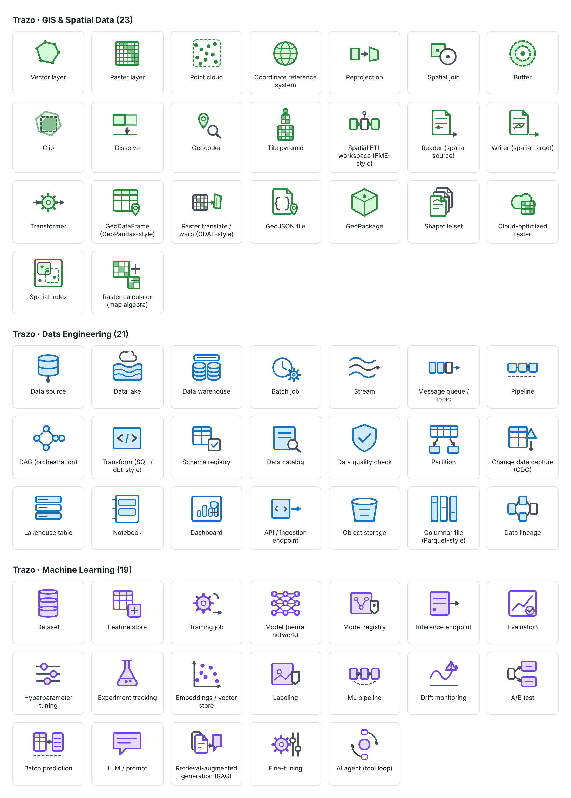

# Libraries, icons and logos

## What ships

`node tools/build-library.js` generates `public/arcgis.excalidrawlib` (git-ignored) with ~150 items in sections:

| Section (as shown in the panel) | Source | License |
| --- | --- | --- |
| Interactive ArcGIS Maps | this project (an embed element) | MIT |
| Utility Network (Esri Calcite icons) | Esri Calcite UI icons | Esri MLA, **fetched at build time, embedded unmodified, not committed** |
| Esri Architecture Center · General / Enterprise Components / Data Stores / IT Components / Containers & Labels / User Types / User Personas | Esri ArcGIS Architecture Center diagramming toolkit, converted from Visio to SVG (`tools/visio_to_svg.py`) | CC BY 4.0 © Esri |
| Services & SDKs (Esri Calcite icons) | Esri Calcite UI icons | Esri MLA, fetched at build time |
| Trazo · GIS & Spatial Data (23) / Trazo · Data Engineering (21) / Trazo · Machine Learning (19) | **own neutral glyphs** drawn by this project (`tools/own-icons/icons.cjs`) | MIT, committed |

Item names are English and prefixed by their section (`<Source · Category> / <Name>`), so search works ("utility", "geodatabase", "persona"). Ids are stable (`arcgis:…`): reloading replaces items, never duplicates them.

The _Containers_ are native rectangles (the toolkit's containers are outline-only boxes) with an icon badge. Calcite glyphs used as badges/Utility Network concepts are **approximations by meaning** (Esri publishes no official icon for several Utility Network concepts, e.g. Device = `switch`). Change a mapping in `tools/build-library.js`.

## Own icon packs

`tools/own-icons/icons.cjs` draws 63 glyphs from a few geometric primitives on a 64 x 64 grid, one stroke style per pack and one accent color per pack (green for GIS, blue for data engineering, violet for machine learning):

- **GIS & Spatial Data**: vector and raster layers, point cloud, coordinate reference system, reprojection, spatial join, buffer, clip, dissolve, geocoder, tile pyramid, spatial ETL workspace, reader, writer, transformer, GeoDataFrame, raster translate / warp, GeoJSON, GeoPackage, shapefile set, cloud-optimized raster, spatial index, raster calculator.
- **Data Engineering**: data source, lake, warehouse, lakehouse table, batch job, stream, message queue, pipeline, DAG, transform, schema registry, catalog, quality check, partition, change data capture, notebook, dashboard, API endpoint, object storage, columnar file, lineage.
- **Machine Learning**: dataset, feature store, training job, neural network, model registry, inference endpoint, evaluation, hyperparameter tuning, experiment tracking, embeddings, labeling, ML pipeline, drift monitoring, A/B test, batch prediction, LLM / prompt, RAG, fine-tuning, AI agent.

They are original and neutral on purpose: no vendor logo, no screenshot, no copy of any product's artwork, so they carry no third-party license and are part of the **public profile** too. A few names mention a tool (`Spatial ETL workspace (FME-style)`, `GeoDataFrame (GeoPandas-style)`, `Raster translate / warp (GDAL-style)`) only so that searching the library for it finds the glyph; the drawing is generic. Ids are `lib:trazo-<pack>:<slug>`, so reloading replaces them and never duplicates them.

To add or change a glyph, edit `tools/own-icons/icons.cjs` (the kit in `kit()` has `rect`, `circ`, `line`, `path`, `poly`, `arrow`, `cyl`, `table`, `doc`, `pin`, `gear`, `grid`, `graph`, `bars`…), run `node tools/own-icons/sheet.cjs` to render a contact sheet at `tools/own-icons/out/sheet.html` (git-ignored) and check it by eye, then `node tools/build-library.js`. `yarn test:app` checks that every glyph is well-formed, self-contained SVG with a unique name.

## Icon licensing rules (read before redistributing)

- **Esri Architecture Center icons**: CC BY 4.0: redistribution and adaptation allowed **with attribution** (kept in README, About dialog, `THIRD_PARTY_NOTICES.md`). The conversion only changes the file format.
- **Esri Calcite icons**: © Esri, under the Esri Master License Agreement. They are included **unmodified**, exactly as downloaded (no recoloring), in the library of every build, and are not committed to this repository: they are downloaded while building.
- Do not use "Esri"/"ArcGIS" as a product name or logo; describing compatibility is fine.

## Community libraries (built in)

`libraries/community.json` lists 16 libraries from the public catalog (authors, source file, item counts; see [THIRD_PARTY_NOTICES.md](../THIRD_PARTY_NOTICES.md) for the table). `node tools/build-library.js`:

1. downloads them from `excalidraw/excalidraw-libraries` into `assets/community/` (git-ignored, never committed);
2. adds each as its own panel section **"Community · <name> (<author>)"** with stable ids `lib:<slug>:<id>`;
3. records the original item ids and a content fingerprint of every item, so on load the app **replaces copies you had imported by hand** (same items, different ids) instead of duplicating them. Items that are not in the pack (your own drawings) are never touched.

**Profiles.** The default profile (`local`) includes everything, and it is what the releases, the installers and the Docker images use. `--profile=public` (or `LIBRARY_PROFILE=public`) is a smaller library for anyone who prefers a build without the libraries flagged `brandLogos` in the manifest (their logos are third-party trademarks) and without the Esri Calcite sections (Utility Network and Services & SDKs; the container boxes keep their title without the glyph). `LIBRARY_OUT=file` writes the library somewhere else and `LIBRARY_OFFLINE=1` downloads nothing.

### Adding or removing a library

Edit `libraries/community.json` (keep `name`, `authors`, `source` exactly as in the catalog, set `brandLogos` honestly, `items` = number of items) and run `node tools/build-library.js`. To list what is in your own browser's library and find which catalog libraries it came from, export it (library menu → ⋮ → Export library) and compare ids with the catalog (the method used to build the manifest: items keep the ids of the catalog files; older imports are matched by content).

### Importing something else

Library panel → **Browse libraries** (opens libraries.excalidraw.com, a normal link) or ⋮ → Open to import a file. Anything imported goes to the standard _Personal_/_Excalidraw library_ sections below the Trazo sections. Check each library's license before redistributing it.
