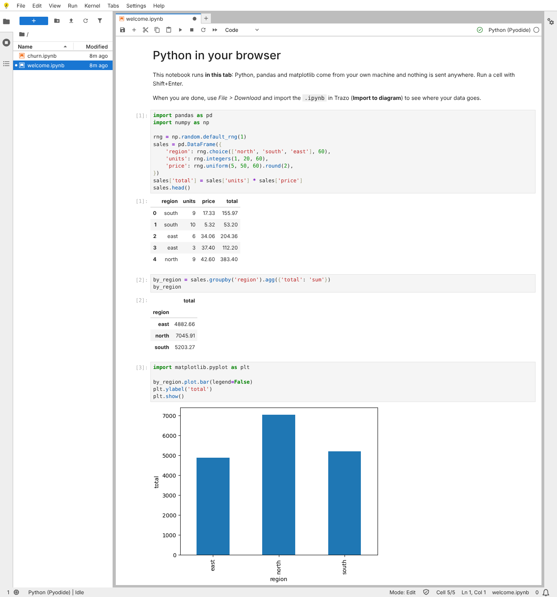
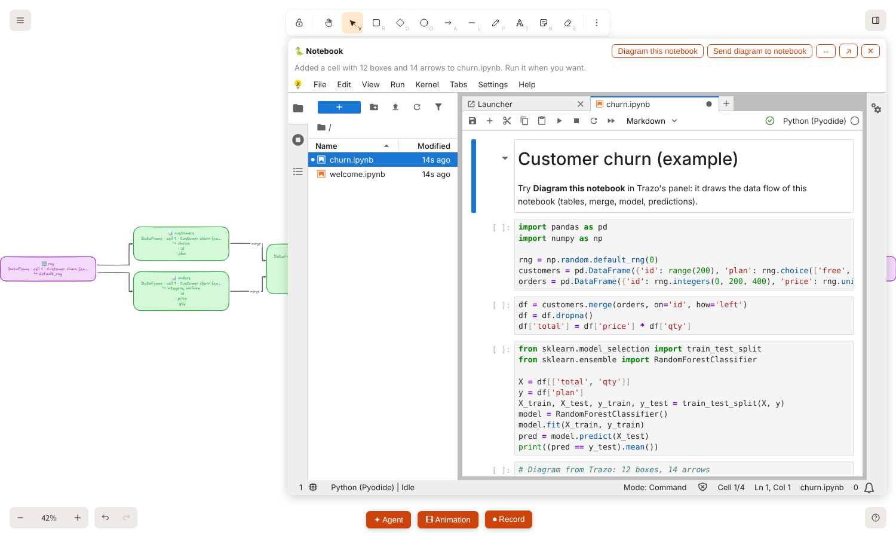

# Python notebooks in the browser

Trazo can open **JupyterLite**: Jupyter notebooks whose Python (with pandas, NumPy, SciPy, scikit-learn, matplotlib, GeoPandas, Shapely, rasterio, DuckDB…) runs **inside the browser tab**, through WebAssembly (Pyodide). There is no Python server, nothing is executed on your computer outside the tab's sandbox, and nothing is sent anywhere.

It is optional and separate from the app: a small static site that you build once and that Docker serves on `127.0.0.1:3002`.

## Set it up

```
node tools/build-jupyterlite.mjs          # once: about 230 MB, needs python3, tar (with bzip2) and node 18+
docker compose --profile lite up -d       # then open http://127.0.0.1:3002
```

Then in Trazo press **🐍 Notebook** (bottom bar), or **Menu → Python notebook…**, or the command palette, or the **Python notebook…** button of **Import to diagram**. The notebook opens in a **panel next to the canvas**, inside Trazo, with two starter notebooks, `welcome.ipynb` and `churn.ipynb`. **✕** hides the panel without stopping anything (the kernel and its variables stay), **⇔** makes it wider and **↗** opens the same notebook site in its own tab.

The first start of a notebook takes some seconds (Pyodide loads), then it is quick. Files you create live in your browser (IndexedDB) for that site: use **File → Download** to keep a notebook as an `.ipynb`.



## Notebook and diagram, in both directions



The panel header has two buttons that connect the notebook with the canvas:

- **Diagram this notebook** draws where the data goes in the notebook that is open (files read, tables, models, files written), **as it is now, saved or not**, with no download. Trazo only reads the notebook as text: it is not run. Ctrl+Z undoes the drawing. The rules are in [IMPORT.md](IMPORT.md#jupyter-notebook), and the same importer takes any `.ipynb` you paste or choose in **Import to diagram**.
- **Send diagram to notebook** adds a code cell at the end of the open notebook with the boxes and arrows on the canvas as two pandas tables (`nodes`: id, label, details, role; `edges`: from, to, label). It is **not run**: you run it. From there you can join the diagram with your data, count, filter or redraw it with NetworkX. So a research loop is: draw or import an architecture, send it to the notebook, analyse it, and diagram the notebook back.

How they talk: the notebook runs in an iframe on its own origin (port 3002), so it cannot read Trazo's storage (settings, AI keys). The two sides exchange a few `postMessage` messages (`excalidraw-app/notebook/protocol.ts` and `tools/lite-bridge.js`), each side checking the origin and the window of the other and the shape of every message. The notebook side answers only to the Trazo origins listed in `PARENT_ORIGINS` (`tools/build-jupyterlite.mjs`, the same list as `frame-ancestors`); if some other page embeds the site, it stays silent. A cell sent to the notebook is only text: a label cannot turn into code, because every label is written as an escaped string literal.


## Local-first: how it stays offline

- `tools/build-jupyterlite.mjs` downloads the official Pyodide distribution **once, on your machine, at build time** (a pinned version, checked against a pinned SHA-256) and keeps the core plus a short list of packages and everything they depend on (all pure-Python packages are kept, about 35 MB, so the kernel never needs PyPI). It builds JupyterLite from pinned pip packages in a throwaway virtualenv inside `assets/jupyterlite-work/`. Nothing is committed (`assets/jupyterlite/` and `assets/jupyterlite-work/` are git-ignored).
- After that the site makes **no network request**. It was checked in a headless browser, requests logged, with the real Content-Security-Policy: none, including running pandas, scikit-learn and matplotlib.
- The container's policy (`deploy/nginx/lite.conf`, plus `_csp.conf` written by the build) allows no origin except itself and `connect-src 'self'`, so a notebook cannot fetch from the network even if it tries. `'wasm-unsafe-eval'` is what WebAssembly needs and `'unsafe-eval'` is what JupyterLab's own code loader needs; both are the cost of running Python in the page. The inline scripts of the JupyterLite pages are allowed by hash, not by `'unsafe-inline'`.
- `pip install` / `%pip install` inside a notebook reads from the packages bundled in the site only. A package that is not there cannot be installed (and would need the network, which is blocked). To add one that Pyodide ships, put its name in `PACKAGES` in `tools/build-jupyterlite.mjs` and rebuild.

## What is and is not there

Included: `micropip`, IPython, NumPy, pandas, SciPy, matplotlib, scikit-learn, statsmodels, NetworkX, SymPy, Pillow, lxml, BeautifulSoup, PyYAML, pydantic, tqdm, joblib, xarray, PyArrow, SQLAlchemy, DuckDB, Shapely, pyproj, Fiona, GeoPandas, rasterio, h5py, netCDF4, and every pure-Python package of Pyodide.

Not possible in the browser sandbox: GDAL command-line tools, FME, PyTorch/TensorFlow, anything that needs a socket or a server, and large datasets (the tab has a few GB of memory at most). Real files on your disk are not visible to the notebook: upload them in the file browser first (they stay in the tab).

## Moving the site

The app embeds `http://<same host>:3002/lab/index.html`. For another port or a domain, set `VITE_APP_JUPYTERLITE_ORIGIN` when building the app (the app's `frame-src` follows it). If the app itself is not on `localhost:3000`, add its origin to `PARENT_ORIGINS` in `tools/build-jupyterlite.mjs` and rebuild the site: that list is both `frame-ancestors` and who the notebook talks to.

## Updating Pyodide or JupyterLite

Versions are pinned in `tools/build-jupyterlite.mjs` (`PYODIDE_VERSION`, `PYODIDE_SHA256`, `PIP_PINS`). Pyodide must be the version the JupyterLite kernel was built for (the kernel's bundled default URL names it). Change them together, rebuild and run a notebook before committing.
