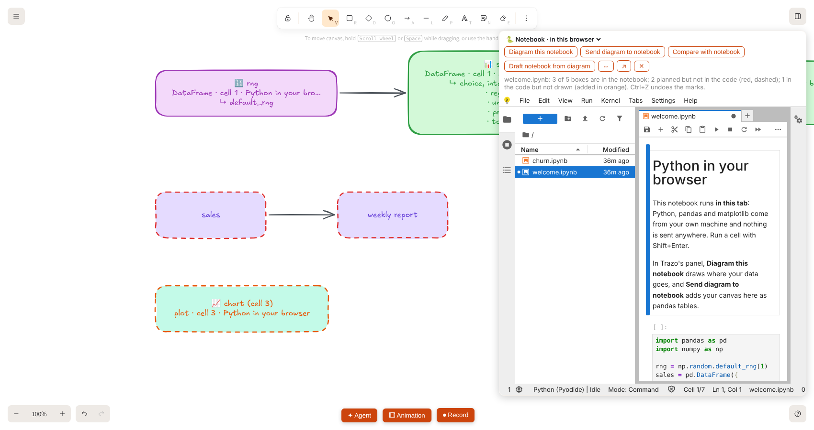
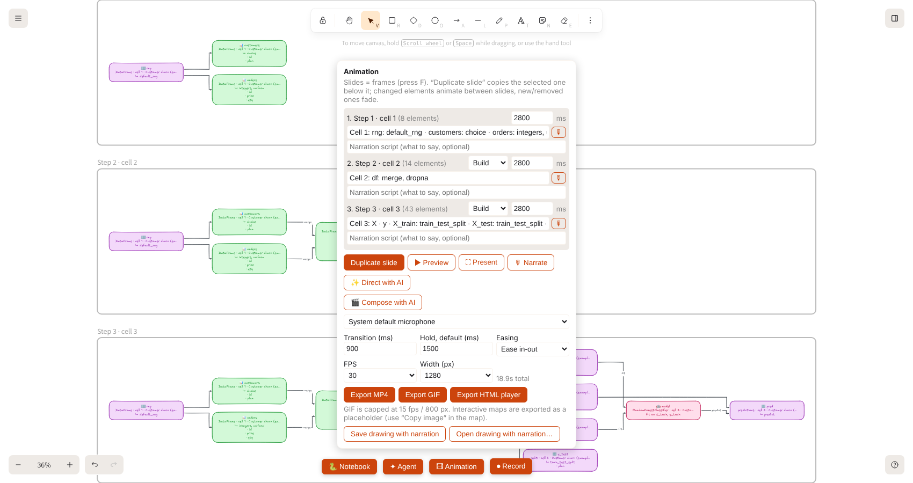
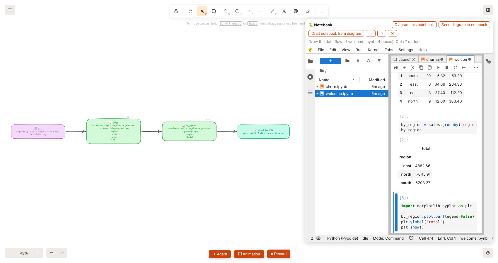
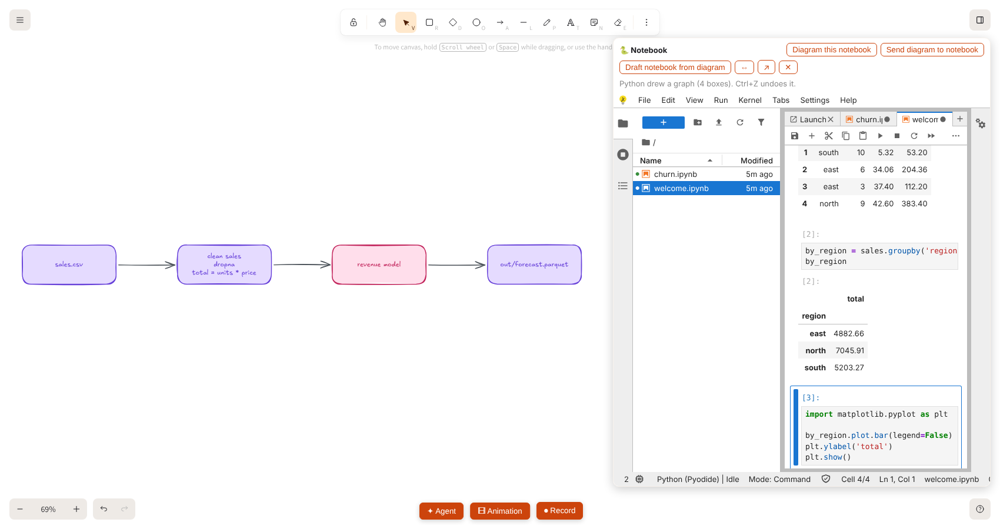
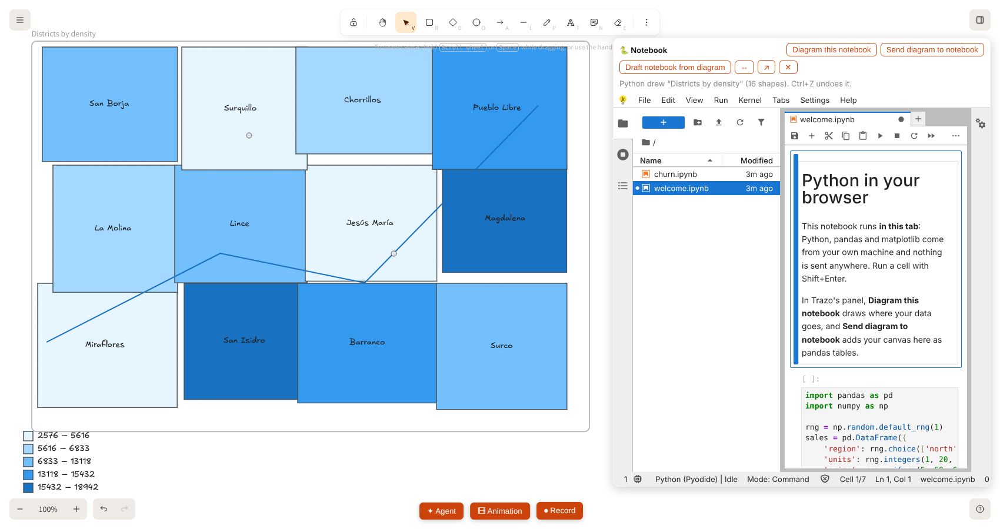
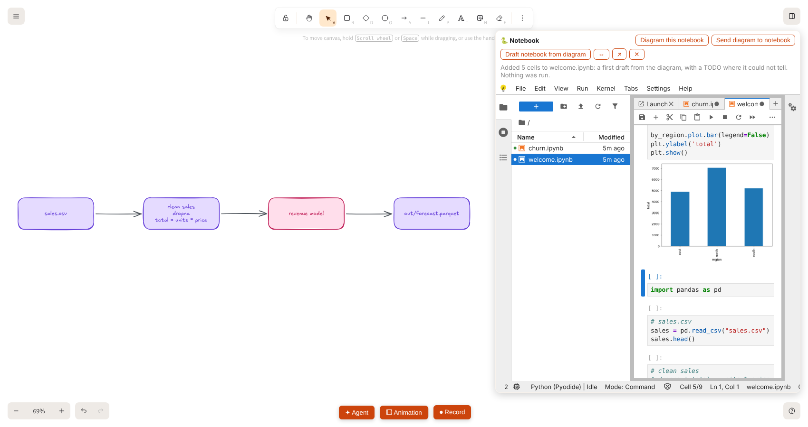
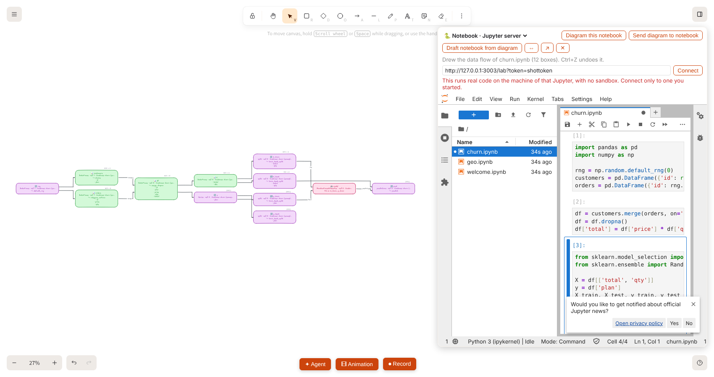

# Python notebooks in the browser


Trazo can open **JupyterLite**: Jupyter notebooks whose Python (with pandas, NumPy, SciPy, scikit-learn, matplotlib, GeoPandas, Shapely, rasterio, DuckDB…) runs **inside the browser tab**, through WebAssembly (Pyodide). There is no Python server, nothing is executed on your computer outside the tab's sandbox, and nothing is sent anywhere.

It is optional and separate from the app: a small static site that you build once and that Docker serves on `127.0.0.1:3002`.

## Set it up

Nothing to do: the notebooks are built **inside Docker** and start with the rest of Trazo.

```
docker compose up -d --build       # then open http://127.0.0.1:3002 (the first build downloads about 230 MB)
```

Without Docker, on a computer that has Python 3, `tar` with bzip2 and Node.js 18+ (on Windows the Python command is `python`): `node tools/build-jupyterlite.mjs` builds the site into `assets/jupyterlite`, and any static server with the headers of `deploy/nginx/lite.conf` can serve it. The `Trazo-Notebook-Pack-X.Y.Z.zip` of a [release](https://github.com/balalex12/trazo/releases) is the same site already built: unzip it so that the folder `assets/jupyterlite` exists.

Then in Trazo press **🐍 Notebook** (bottom bar), or **Menu → Python notebook…**, or the command palette, or the **Python notebook…** button of **Import to diagram**. The notebook opens in a **panel next to the canvas**, inside Trazo, with starter notebooks, `welcome.ipynb` and `churn.ipynb`. **✕** hides the panel without stopping anything (the kernel and its variables stay), **⇔** makes it wider and **↗** opens the same notebook site in its own tab.

The first start of a notebook takes some seconds (Pyodide loads), then it is quick. Files you create live in your browser (IndexedDB) for that site: use **File → Download** to keep a notebook as an `.ipynb`.


## Notebook and diagram, in both directions

The panel header has five buttons that connect the notebook with the canvas, and two things happen on their own while you work:

- **Diagram this notebook** draws where the data goes in the notebook that is open (files read, tables, models, files written), **as it is now, saved or not**, with no download. Trazo only reads the notebook as text: it is not run. Ctrl+Z undoes the drawing, and the drawing is fitted into the free space next to the panel. The rules are in [IMPORT.md](IMPORT.md#jupyter-notebook), and the same importer takes any `.ipynb` you paste or choose in **Import to diagram**.
- **Send diagram to notebook** adds a code cell at the end of the open notebook with the boxes and arrows on the canvas as two pandas tables (`nodes`: id, label, details, role; `edges`: from, to, label). It is **not run**: you run it.
- **Draft notebook from diagram** is the importer the other way round: it writes a first draft of a notebook from the diagram, one code cell per box in the order the data flows (imports first). Boxes named like a file become a read (`pd.read_csv`, `read_parquet`, `gpd.read_file`, `rasterio.open`…), a box that ends the flow and is named like a file becomes a write, the steps in between are `TODO`s that keep the box's name and details as comments, and a box with two inputs becomes a `merge`. No AI: the same diagram gives the same cells, which are valid Python and are **not run**.

- **Compare with notebook** is the design against the reality: the diagram is what you planned, the notebook is what the code does. Trazo reads the open notebook (it is not run), matches each box with a part of the notebook by name and marks the differences on the canvas: boxes **planned but not in the code** in dashed red, arrows **drawn but with no code behind** in dashed red, and what **the code does but is not drawn** added below in dashed orange. It also says, in one sentence, what it found (and data flows that are in the code and not drawn). Matching is deliberately conservative and local (no AI): a box drawn _from_ a variable matches that variable for certain; otherwise the same name, or all the words of the shorter name inside the longer one, and a name that does not decide between two candidates (or a one-letter name such as `x` against `x_train`) is left unmatched rather than guessed. A box and its notebook part need not be called exactly the same: `customers.csv`, `customers` and `📊 customers` match. Compare again after you change the diagram or the notebook: the previous marks are replaced, not piled up, and each comparison is one Ctrl+Z.



- **Slides from notebook** turns the diagram of a notebook into an **explainer**: one slide (a frame of the Animation panel) per step of the analysis, that is, per code cell that made something. Each slide shows everything built so far and the boxes that the cell added appear one after another (the **Build** transition; arrows draw themselves), with a caption that says what the cell added (`Cell 2: df: merge, dropna`). The slides are ordinary frames under the diagram, so the **Animation** panel plays them, exports them (MP4, GIF, HTML player), records narration, and **Direct with AI** / **Compose with AI** can rewrite the captions and write the script with your own model. It needs a diagram made by _Diagram this notebook_ (or the notebook import), whose boxes know their cell. No AI is involved in making the slides. Ctrl+Z removes them.



### A narrated video from a notebook

The slides are ordinary Animation slides, so the rest of the chain already exists; nothing here needs more than what the Animation panel and `tools/hyperframes-render.mjs` already use:

1. **Diagram this notebook**, then **Slides from notebook** (frames are 16:9, the shape of a video).
2. Optional: **Direct with AI** writes a narration script for each slide in the language you ask for (your own model, see [AI.md](AI.md)). You can also type the scripts by hand in the **Narration script** field of each slide.
3. **Export HTML player**, then, on your computer:

```
pip install kokoro-onnx soundfile          # once: the local voice
node tools/hyperframes-render.mjs animation.html --tts --lang es --size 1920x1080 -o analysis.mp4
```

It needs Node.js 22, FFmpeg and a Chrome or Chromium. The first run downloads the HyperFrames package and the voice model (about 330 MB); after that everything runs offline and nothing is uploaded. Tried with the three-cell example notebook: scripts in Spanish from a cloud model, a 33 s, 1920 x 1080 H.264 video with an AAC voice track, about 2.5 minutes to render at draft quality without a GPU. A very wide diagram stays a band in the middle of the picture; a notebook with a narrower diagram fills it better.



**The diagram follows your notebook.** For a diagram drawn from a notebook, each box knows its cell and its variable. While a cell runs, its boxes light up in orange; when it finishes they flash green and go back. After every run the kernel is asked, quietly (not stored in the history), what its tables and arrays are, and each box shows the real size next to it (`400 × 3`, `(400,)`). So the diagram is a live view of the analysis, not a drawing that goes stale. These labels are not part of the diagram: they are skipped when the canvas is sent to a notebook or to the Agent.

### The `trazo` module: Python talks to the canvas

Every notebook in the panel starts with the `trazo` module installed (`import trazo`):

```python
import pandas as pd
import trazo

trazo.draw(graph)               # a NetworkX graph, a DataFrame of edges, {"nodes": [...], "edges": [...]} or [(a, b), ...]
nodes, edges = trazo.canvas()   # the diagram on the canvas, as two pandas tables
nodes, edges = trazo.selected() # the same, only for the boxes you selected
```

`draw` puts the graph on the canvas (hand-drawn, laid out left to right, undoable); a node may carry `label`, `details` (a list of lines) and `role` (`database`, `cache`, `queue`, `storage`, `function`…). Up to 150 nodes. `canvas()` and `selected()` give the canvas **as it was when the previous cell finished**: Trazo sends a fresh copy to every notebook that imported the module each time the diagram or the selection changes, and a notebook can only receive messages between cells (waiting for an answer inside a cell would block). Put `import pandas as pd` in the cell so the notebook loads pandas. This works only in the panel inside Trazo; elsewhere it says so.



### Geodata: `trazo.map`

GeoPandas, Shapely and pyproj run in the page, and `trazo.map` draws geometry on the canvas as a **hand-drawn map**:

```python
import geopandas as gpd
import trazo

trazo.map([districts, river, stations], color="density", label="name", title="Districts by density")
```

It takes a GeoDataFrame, a GeoSeries, shapely geometries or GeoJSON (anything with a `__geo_interface__`), or a list of them drawn together. Polygons are filled (holes in white), lines are drawn open and points are dots, all inside a frame named after `title`, with a legend under it. `color="column"` paints by a column: five quantile classes for numbers, the most common values (and "other") for text. `label="column"` writes that column on each shape (up to 80). Geographic coordinates (longitude, latitude) are drawn in Web Mercator and projected ones as they are, so `gdf.to_crs(...)` first when you want a particular projection. Up to 1000 features; the geometry is simplified (Douglas-Peucker, `max_vertices`, 2500 by default) so the canvas stays light, and the legend says when it was. Ctrl+Z undoes it.

There is **no basemap**: nothing is fetched from anywhere, which is what keeps it local-first. The ArcGIS map viewer of Trazo ([VIEWER.md](VIEWER.md)) is a different thing: it loads Esri's SDK from the internet, so it is not used for this.



The starter notebook `geo.ipynb` has this example.



### How they talk, and why it is safe

The notebook runs in an iframe on its own origin (port 3002), so it cannot read Trazo's storage (settings, AI keys). The two sides exchange a few `postMessage` messages (`excalidraw-app/notebook/protocol.ts`, `tools/lite-bridge.js`), each side checking the origin and the window of the other and the shape of every message; sizes are capped and unknown fields ignored. The notebook side answers only to the Trazo origins listed in `PARENT_ORIGINS` (`tools/build-jupyterlite.mjs`, the same list as `frame-ancestors`); if some other page embeds the site, it stays silent. Code in a notebook can therefore do two things to Trazo: **draw boxes and arrows** and **read the diagram on the canvas** (its text and connections), nothing else. A cell sent to the notebook is only text: a label cannot turn into code, because every label is written as an escaped string literal. Nothing is run for you.


## Local-first: how it stays offline

- `tools/build-jupyterlite.mjs` downloads the official Pyodide distribution **once, on your machine, at build time** (a pinned version, checked against a pinned SHA-256) and keeps the core plus a short list of packages and everything they depend on (all pure-Python packages are kept, about 35 MB, so the kernel never needs PyPI). It builds JupyterLite from pinned pip packages in a throwaway virtualenv inside `assets/jupyterlite-work/`. Nothing is committed (`assets/jupyterlite/` and `assets/jupyterlite-work/` are git-ignored).
- After that the site makes **no network request**. It was checked in a headless browser, requests logged, with the real Content-Security-Policy: none, including running pandas, scikit-learn and matplotlib.
- The container's policy (`deploy/nginx/lite.conf`, plus `_csp.conf` written by the build) allows no origin except itself and `connect-src 'self'`, so a notebook cannot fetch from the network even if it tries. `'wasm-unsafe-eval'` is what WebAssembly needs and `'unsafe-eval'` is what JupyterLab's own code loader needs; both are the cost of running Python in the page. The inline scripts of the JupyterLite pages are allowed by hash, not by `'unsafe-inline'`.
- `pip install` / `%pip install` inside a notebook reads from the packages bundled in the site only. A package that is not there cannot be installed (and would need the network, which is blocked). To add one that Pyodide ships, put its name in `PACKAGES` in `tools/build-jupyterlite.mjs` and rebuild.

## Use your own Python: a Jupyter server

The notebook in the browser has the limits of a browser (no GDAL, no PyTorch, no sockets, a few GB of memory). When you need your own packages, your data or a GPU, the panel can use **a Jupyter server you run yourself** instead. In the panel header, change **🐍 Notebook · in this browser** to **🐍 Notebook · Jupyter server**.

```
# in your environment (a venv, conda, a container… with jupyterlab and ipykernel)
jupyter labextension disable @jupyterlab/apputils-extension:announcements
jupyter lab --no-browser --LabApp.expose_app_in_browser=True \
            --LabApp.check_for_updates_class=jupyterlab.NeverCheckForUpdate
# it prints a URL with a token, for example http://127.0.0.1:8888/lab?token=abc…

# next to Trazo (node 18+, nothing to install): a small local proxy that lets Trazo embed that Jupyter
node tools/jupyter-proxy.mjs --target http://127.0.0.1:8888
```

Then type `http://127.0.0.1:3003/lab?token=abc…` (the address of the proxy and the token Jupyter printed) in the box of the panel and press **Connect**. From then on the panel works as with the notebook in the browser: **Diagram this notebook**, **Send diagram to notebook**, **Draft notebook from diagram**, the boxes that light up while a cell runs and show the size of your tables, and the `trazo` module. In that Python, install the module once: `pip install ./tools/lite-python` (it is a plain pure-Python package; `import trazo` then also gives `trazo.map` and everything above). `tools/lite-python` is in this repository; it is not on PyPI.



What the proxy does, and what it does not:

- It listens on `127.0.0.1` only, and answers only requests addressed to itself (a web page cannot reach it through DNS rebinding).
- It adds **no login and keeps no secret**: Jupyter's token stays Jupyter's. Trazo remembers only the address, never the token (the token lives in memory for the session; Jupyter keeps its own login in a cookie).
- It changes Jupyter's answers in two ways only: the Trazo origins may embed the page (`frame-ancestors`), and the bridge script is added to the JupyterLab page. Everything else, including the WebSockets of the kernels, passes through.
- It refuses a target that is not on this machine unless you add `--allow-remote-target`. A remote Jupyter runs your code elsewhere and Trazo sends it the canvas on request, so that is your call. The panel accepts `http://` only for localhost; any other address must be `https://`.
- The Trazo app's `frame-src` allows `http://localhost:3003` and `http://127.0.0.1:3003` (the proxy's default port) and any `https:` address; a proxy on another port needs it added in `scripts/csp-hashes.mjs`.

**This is not a sandbox.** Code in that Jupyter runs on the machine that runs it, with that machine's files and network, exactly as if you ran it in a terminal. That is why the panel says so, why the browser-based Python stays the default, and why nothing starts it for you. Connect only to a Jupyter you started, and keep its token private. JupyterLab itself has two features that talk to the internet; the commands above turn them off: the "news" prompt (it fetches from jupyter.org if you accept) and the update check. Trazo's own promise (no request leaves the machine) covers Trazo and the notebook in the browser; what your own Jupyter and its packages do is up to your environment.

## What is and is not there (in the browser)

Included: `micropip`, IPython, NumPy, pandas, SciPy, matplotlib, scikit-learn, statsmodels, NetworkX, SymPy, Pillow, lxml, BeautifulSoup, PyYAML, pydantic, tqdm, joblib, xarray, PyArrow, SQLAlchemy, DuckDB, Shapely, pyproj, Fiona, GeoPandas, rasterio, h5py, netCDF4, and every pure-Python package of Pyodide.

Not possible in the browser sandbox: GDAL command-line tools, FME, PyTorch/TensorFlow, anything that needs a socket or a server, and large datasets (the tab has a few GB of memory at most). Real files on your disk are not visible to the notebook: upload them in the file browser first (they stay in the tab). For any of that, use [your own Python](#use-your-own-python-a-jupyter-server).

## Moving the site

The app embeds `http://<same host>:3002/lab/index.html`. For another port or a domain, set `VITE_APP_JUPYTERLITE_ORIGIN` when building the app (the app's `frame-src` follows it). If the app itself is not on `localhost:3000`, add its origin to `PARENT_ORIGINS` in `tools/build-jupyterlite.mjs` and rebuild the site: that list is both `frame-ancestors` and who the notebook talks to.

## Updating Pyodide or JupyterLite

Versions are pinned in `tools/build-jupyterlite.mjs` (`PYODIDE_VERSION`, `PYODIDE_SHA256`, `PIP_PINS`). Pyodide must be the version the JupyterLite kernel was built for (the kernel's bundled default URL names it). Change them together, rebuild and run a notebook before committing.
